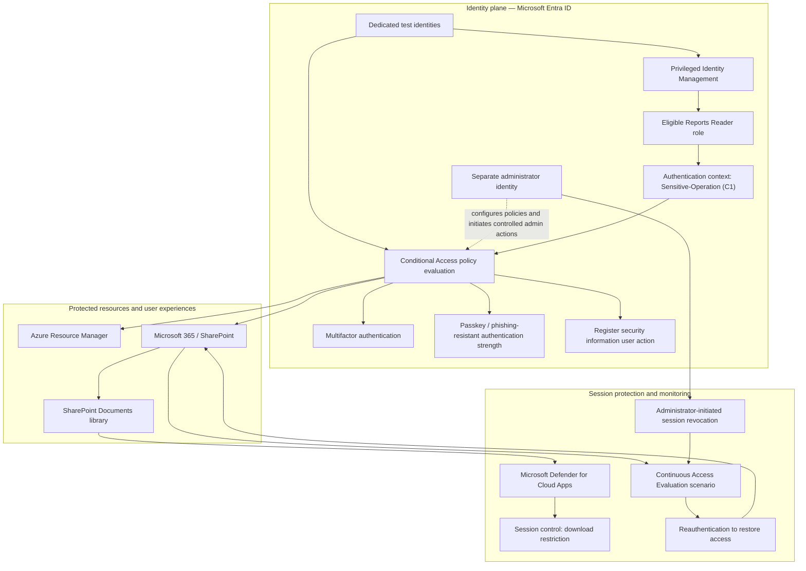

# Portfolio Architecture

This diagram is a **logical view of the completed lab scenarios**, not a claim that every control was deployed as one integrated production architecture. The labs were performed as separate, controlled exercises in a non-production Microsoft Entra tenant.

## Identity and access control overview

## How to read the architecture

### 1. Identity and policy evaluation

Dedicated test identities authenticate through Microsoft Entra ID. Conditional Access evaluates the applicable user, resource, conditions, and access controls. The completed labs exercise different policy scenarios rather than one universal policy:

- MFA for Azure Resource Manager access (Lab 02; Report-only evaluation).
- MFA for security-information registration (Lab 04).
- Phishing-resistant authentication strength with a registered passkey (Lab 11).
- Operating-system and device-ownership restrictions (Labs 06 and 07).
- Authentication context C1 combined with PIM Reports Reader activation (Lab 08).

The administrator identity is separate from the test identity and is excluded from the relevant policies where documented.

### 2. Protected cloud resources

The lab scenarios target cloud resources including Azure Resource Manager and Microsoft 365/SharePoint. SharePoint provides the application context for the session-control and CAE exercises.

### 3. Session protection with Defender for Cloud Apps

In Lab 09, a SharePoint browser session was routed through Microsoft Defender for Cloud Apps. The test file `iam-lab.txt` was used to validate a download restriction. The evidence distinguishes the proxy notification (session routing) from the blocked-download and matched-policy evidence (enforcement).

### 4. Session lifecycle and CAE

Lab 10 records a CAE-capable SharePoint sign-in, administrator-initiated session revocation, a subsequent sign-in/reauthentication flow, audit evidence, and restored SharePoint access. The evidence does **not** establish that the failed request itself was processed as a CAE token or that a CAE claims challenge was directly logged.

## Lab-to-architecture mapping

| Architecture component | Related lab(s) | What the evidence demonstrates |
|---|---|---|
| Conditional Access policy evaluation | 01–10 | Policy configuration and the specific evaluation or outcome recorded in each lab |
| Azure Resource Manager | 02 | MFA grant evaluation in Report-only mode |
| Security-information registration | 04 | Registration user action targeted by an enabled MFA policy |
| Device and platform conditions | 05–07 | Configuration and/or sign-in outcomes, with Lab 05 still partially completed |
| PIM and authentication context | 08 | Eligible Reports Reader activation and C1 Conditional Access evaluation |
| Defender for Cloud Apps | 09 | SharePoint session routing and download-block enforcement evidence |
| Continuous Access Evaluation scenario | 10 | CAE-capable sign-in, session revocation, reauthentication, and audit evidence |
| Phishing-resistant authentication | 11 | Jones passkey registration and successful phishing-resistant authentication-strength evaluation |

## Scope and interpretation

- This is a portfolio architecture diagram that consolidates the relationships demonstrated across separate labs.
- It is not a network topology, deployment manifest, or production reference architecture.
- It does not imply that all listed policies are simultaneously enabled or target the same identities and resources.
- Lab 01 used Report-only mode; its result must not be described as an enforced block.
- Lab 05 remains partially completed; its end-to-end device-registration validation is pending.
- Consult each lab's configuration and test-results documents for exact settings, observed results, and limitations.
